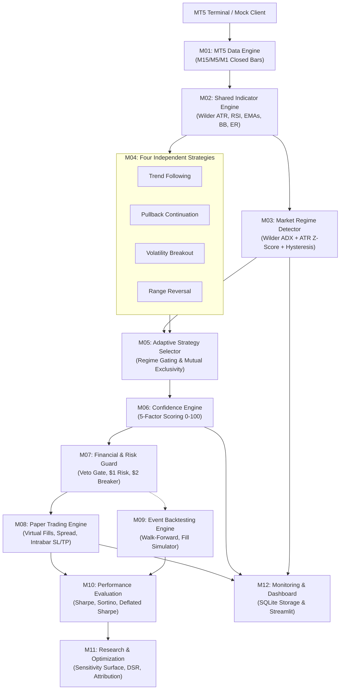

# AI GOLD WATCHER V4 — Autonomous Quantitative Trading System

[](https://www.metatrader5.com)
[-gold.svg)]()
[]()
[]()
[]()
[-success.svg)]()

AI GOLD WATCHER V4 is an institutional-grade, decoupled quantitative trading environment engineered for Gold (`XAUUSDm`) on Exness MetaTrader 5 under Windows 11. 

Designed under strict mathematical and financial guardrails, V4 features dynamic regime detection, multi-strategy orchestration, 5-factor confidence scoring, a rigid \$1.00 risk budget per trade on \$50.00 capital, and zero live order execution capability during development.

---

## 🔒 Strict Trading Safety Guardrails (Zero-Tolerance)
- **Zero Live Execution**: Real `mt5.order_send` calls are completely barred; development runs in paper trading or mock mode.
- **Micro-Account Calibration**: Reference capital \$50.00 USD, initial volume 0.01 lot (1 troy oz; contract size 100).
- **Target Risk Budget**: \$1.00 max risk per trade (2.0% of balance).
- **Stop Loss Distance Cap**: 100 points (\$1.00) max. Any setup requiring SL > 100 pts is strictly rejected.
- **Mutual Exclusivity**: Max 1 concurrent position allowed across all 4 strategy engines.
- **Daily Loss Circuit Breaker**: -\$2.00 cumulative daily loss trips an automated trading halt for the session.
- **Consecutive Loss Breaker**: 3 consecutive losses pauses execution for review.
- **No Martingale / No Grid / No Uncontrolled Averaging Down**.

---

## 🏛️ 12-Module Decoupled Architecture



---

## ⚡ Quickstart Guide (Windows 11)

### 1. Requirements Installation
```powershell
.\install.bat
# Or manually:
python -m pip install -r requirements.txt
```

### 2. Run Automated Verification Tests
```powershell
.\run_tests.bat
# Or:
python -m pytest -v
```
*(Runs 53 comprehensive unit, integration, and backtest tests; all pass in < 2 seconds).*

### 3. Run System Diagnostic Check
```powershell
.\diagnose.bat
# Or:
python src/main.py --mode diagnose
```

### 4. Run Paper Trading Simulation
```powershell
.\run_paper.bat
# Or:
python src/main.py --mode paper --mock --bars 300
```

### 5. Run Event-Driven Historical Backtest
```powershell
.\run_backtest.bat
# Or:
python src/main.py --mode backtest --bars 500 --output reports/backtest_tearsheet.md
```

### 6. Launch Real-Time Streamlit Dashboard
```powershell
.\run_dashboard.bat
# Or:
streamlit run src/monitoring/dashboard.py
```

---

## 📊 Core Documentation Index
- [Architecture & Design](ARCHITECTURE.md)
- [Windows 11 Setup Guide](WINDOWS_SETUP.md)
- [Trading Strategy Documentation](STRATEGY_DOCUMENTATION.md)
- [Financial Risk & Safety Manual](RISK_DOCUMENTATION.md)
- [Backtesting & Validation Guide](BACKTESTING_GUIDE.md)
- [Automated Test Report](TEST_REPORT.md)
- [Implementation Status Ledger](IMPLEMENTATION_STATUS.md)
- [Persistent Project Memory](project_memory/PROJECT_MASTER.md)
